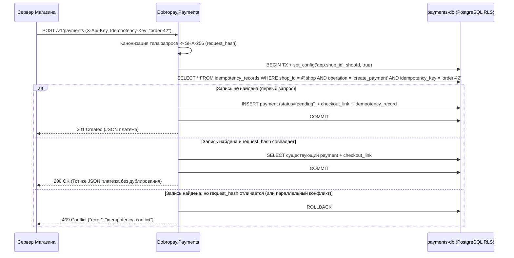
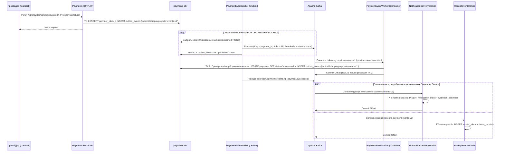
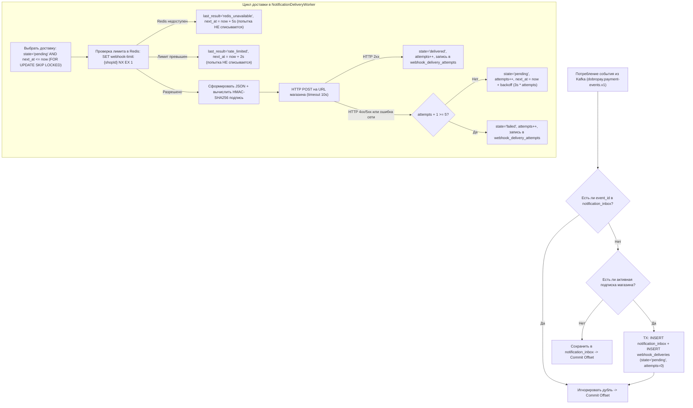

# Схема работы API, Apache Kafka и Webhook в Dobropay

Документ содержит полную техническую спецификацию и визуальные схемы синхронных (HTTP API) и асинхронных (Apache Kafka, Transactional Outbox/Inbox, Webhooks) потоков данных между микросервисами Dobropay.

---

## 1. Общая схема потоков данных (End-to-End Architecture Flow)

```mermaid
flowchart TB
  subgraph External["Внешний контур"]
    Merchant["Сервер магазина (Merchant Backend)"]
    Buyer["Покупатель (Checkout UI)"]
    Staff["Сотрудник магазина (Merchant Admin UI)"]
    Provider["Платёжный провайдер (Sandbox / СБП / Карты / Крипто)"]
    MerchantWebhook["Webhook-приёмник магазина"]
  end

  subgraph GatewayLayer["Входной шлюз"]
    Caddy["Gateway (Caddy :8080)"]
  end

  subgraph Services["Микросервисы Dobropay (Database-per-Service)"]
    Auth["Dobropay.Auth (auth-db)"]
    DevApi["Dobropay.DeveloperApi (merchant-dev-db)"]
    Admin["Dobropay.MerchantAdmin (stateless)"]
    Pay["Dobropay.Payments (payments-db)"]
    Notif["Dobropay.Notifications (notifications-db + redis)"]
    Rec["Dobropay.Receipts (receipts-db)"]
    Email["Dobropay.Email (SMTP -> Mailpit)"]
  end

  subgraph Messaging["Шина событий Apache Kafka (KRaft)"]
    TopicProv[["dobropay.provider-events.v1"]]
    TopicPay[["dobropay.payment-events.v1"]]
    TopicDlq[["dobropay.dlq.<consumer>.v1"]]
  end

  Merchant -->|1. POST /v1/payments (X-Api-Key, Idempotency-Key)| Caddy
  Buyer -->|2. GET/POST /checkout/{token}/*| Caddy
  Provider -->|3. POST /v1/provider/*/events (X-Provider-Signature)| Caddy
  Staff -->|4. /v1/auth/*, /v1/developer/*, /v1/admin/* (Bearer)| Caddy

  Caddy --> Auth
  Caddy --> DevApi
  Caddy --> Admin
  Caddy --> Pay
  Caddy --> Notif

  Pay -->|X-Internal-Key: /internal/v1/keys/resolve| DevApi
  DevApi -->|X-Internal-Key: /internal/v1/sessions/resolve| Auth
  DevApi -->|X-Internal-Key: /internal/v1/shops/{id}/subscriptions| Notif
  Admin -->|X-Internal-Key: агрегация чтения и команд| Auth & DevApi & Pay & Notif & Rec

  Pay -->|Outbox: provider.event.accepted| TopicProv
  TopicProv -->|Consumer: payments-provider-events-v1| Pay
  Pay -->|Outbox: payment.* / refund.*| TopicPay

  TopicPay -->|Consumer: notifications-payment-events-v1| Notif
  TopicPay -->|Consumer: receipts-payment-events-v1| Rec
  Pay & Notif & Rec -.->|Неизвестная версия/тип| TopicDlq

  Notif -->|POST + X-Dobropay-Signature (HMAC-SHA256)| MerchantWebhook
  Rec -->|X-Internal-Key: /internal/v1/email| Email
```

---

## 2. Схема работы API (Публичный, Checkout и Внутренний контуры)

### 2.1. Контуры безопасности и заголовки аутентификации

| Контур | Заголовок | Как проверяется | Изоляция данных (Multi-Tenancy) |
| --- | --- | --- | --- |
| **API магазина (`Payments`)** | `X-Api-Key: dp_test_...` / `dp_live_...`<br>`Idempotency-Key: <1..200 chars>` | `Payments` вычисляет SHA-256 ключа и вызывает `POST /internal/v1/keys/resolve` в `DeveloperApi`. | Возвращённый `shopId` устанавливается в транзакции БД через `SELECT set_config('app.shop_id', shopId, true)`, активируя политики PostgreSQL RLS. |
| **Кабинет и Dev API (`Auth`, `DeveloperApi`, `MerchantAdmin`)** | `Authorization: Bearer <access_token>` | Токен проверяется через `POST /internal/v1/sessions/resolve` в `Auth`, затем проверяется членство сотрудника в магазине (`GET /internal/v1/memberships/{accountId}/{shopId}`). | При отсутствии членства возвращается `404 Not Found` (защита от перебора `shopId`). |
| **Гостевой Checkout (`/checkout/{token}`)** | Подписанный/случайный токен в URL | Поиск в `checkout_links` (`payments-db`) с проверкой `expires_at > now`. Просроченный токен даёт `410 Gone`. | Операция выполняется строго в контексте `shop_id` и `payment_id`, привязанных к `checkout_links`. |
| **Межсервисный API (`/internal/v1/*`)** | `X-Internal-Key: <secret>` | Сравнение за константное время (`CryptographicOperations.FixedTimeEquals`) через `IInternalKeyValidator`. | Маршруты `/internal/*` не проксируются наружу в `infra/Caddyfile` и доступны только внутри приватной Docker-сети. |

---

### 2.2. Схема идемпотентности мутирующих запросов (`Idempotency-Key`)

По аналогии с архитектурой ЮKassa все операции создания/изменения финансового состояния требуют заголовок `Idempotency-Key`.



---

### 2.3. Полный реестр маршрутов API

#### Публичные маршруты (через Gateway `:8080`)
| Метод и маршрут | Сервис-обработчик | Назначение | Статус |
| --- | --- | --- | --- |
| `POST /v1/auth/login` | `Dobropay.Auth` | Вход сотрудника по email и паролю, выдача `access_token`. | Реализовано |
| `POST /v1/auth/register` | `Dobropay.Auth` | Регистрация нового сотрудника/владельца магазина. | В роадмапе (Этап 4) |
| `POST /v1/developer/shops/{shopId}/keys` | `Dobropay.DeveloperApi` | Выпуск нового серверного API-ключа магазина. | Реализовано |
| `PUT /v1/developer/shops/{shopId}/webhooks` | `Dobropay.DeveloperApi` | Настройка URL и секрета подписи для исходящих webhook. | Реализовано |
| `PUT /v1/developer/shops/{shopId}/onboarding` | `Dobropay.DeveloperApi` | Заполнение анкеты организации (ИНН, ОГРН, БИК, счёт). | В роадмапе (Этап 4) |
| `POST /v1/payments` | `Dobropay.Payments` | Идемпотентное создание платежа в копейках (`RUB`). | Реализовано |
| `GET /v1/payments/{id}` | `Dobropay.Payments` | Получение актуального состояния платежа по API-ключу. | Реализовано |
| `POST /v1/payments/{id}/capture` | `Dobropay.Payments` | Подтверждение двухстадийного холда (`waiting_for_capture -> succeeded`). | В роадмапе (Этап 1) |
| `POST /v1/payments/{id}/cancel` | `Dobropay.Payments` | Отмена холда (`waiting_for_capture -> canceled`). | В роадмапе (Этап 1) |
| `POST /v1/refunds` | `Dobropay.Payments` | Создание полного или частичного возврата (`Refund`). | В роадмапе (Этап 1) |
| `GET /v1/refunds/{id}` | `Dobropay.Payments` | Получение статуса возврата. | В роадмапе (Этап 1) |
| `GET /checkout/{token}` | `Dobropay.Payments` | Страница гостевого Checkout покупателя. | Реализовано |
| `POST /checkout/{token}/start` | `Dobropay.Payments` | Старт или переиспользование попытки оплаты у провайдера. | Реализовано |
| `POST /checkout/{token}/simulate/{outcome}` | `Dobropay.Payments` | Симуляция `succeeded` или `canceled` в локальной песочнице. | Реализовано |
| `POST /v1/provider/sandbox/events` | `Dobropay.Payments` | Входящий подписанный callback от провайдера. | Реализовано |
| `GET /v1/receipts/lookup` | `Dobropay.Receipts` | Публичный поиск чека покупателем (страница `#receipts`). | В роадмапе (Этап 3) |
| `GET /v1/admin/shops/{shopId}/payments` | `Dobropay.MerchantAdmin` | Список платежей магазина для личного кабинета. | Реализовано |
| `GET /v1/admin/shops/{shopId}/payments/{id}` | `Dobropay.MerchantAdmin` | Детали платежа в личном кабинете. | Реализовано |
| `GET /v1/admin/shops/{shopId}/deliveries` | `Dobropay.MerchantAdmin` | История доставки исходящих webhook магазина. | Реализовано |
| `GET /v1/admin/shops/{shopId}/receipts` | `Dobropay.MerchantAdmin` | Список квитанций/чеков и статус отправки email. | Реализовано |
| `GET /local/webhooks/received` | `Dobropay.Notifications` | Просмотр доставленных webhook в локальном демо-приёмнике. | Реализовано |

#### Внутренние межсервисные маршруты (только внутри приватной сети, заголовок `X-Internal-Key`)
| Метод и маршрут | Вызывающий → Владелец | Назначение |
| --- | --- | --- |
| `POST /internal/v1/sessions/resolve` | `DeveloperApi`, `MerchantAdmin` → `Auth` | Проверка Bearer-токена и получение `accountId`, `email`. |
| `POST /internal/v1/keys/resolve` | `Payments` → `DeveloperApi` | Проверка SHA-256 хеша `X-Api-Key`, возврат `shopId` и `shopName`. |
| `GET /internal/v1/memberships/{accountId}/{shopId}` | `MerchantAdmin` → `DeveloperApi` | Проверка членства и роли сотрудника в магазине. |
| `PUT /internal/v1/shops/{shopId}/subscriptions` | `DeveloperApi` → `Notifications` | Сохранение URL и секрета подписи webhook в `notifications-db`. |
| `GET /internal/v1/shops/{shopId}/payments` | `MerchantAdmin` → `Payments` | Чтение платежей магазина под RLS-контекстом `shopId`. |
| `GET /internal/v1/shops/{shopId}/payments/{id}` | `MerchantAdmin` → `Payments` | Чтение деталей конкретного платежа магазина. |
| `GET /internal/v1/shops/{shopId}/deliveries` | `MerchantAdmin` → `Notifications` | Чтение истории доставок webhook магазина. |
| `GET /internal/v1/shops/{shopId}/receipts` | `MerchantAdmin` → `Receipts` | Чтение квитанций и чеков магазина. |
| `POST /internal/v1/email` | `Receipts` → `Email` | Передача сформированного письма для отправки по SMTP. |

---

## 3. Схема работы Apache Kafka (Outbox, Топики, Inbox, DLQ)

### 3.1. Архитектура Transactional Outbox и Transactional Inbox

В Dobropay ни один сервис не отправляет сообщения в Kafka напрямую во время HTTP-запроса. Вместо этого используется связка **Transactional Outbox → Kafka → Transactional Inbox**:



---

### 3.2. Карта топиков, партиций и Consumer Groups

Во всех топиках ключ сообщения (`Message.Key`) — **`payment_id` в формате `N` (32 hex-символа без дефисов)**. Это гарантирует, что все события одного платежа (`provider.event.accepted`, `payment.waiting_for_capture`, `payment.succeeded`, `refund.succeeded`) всегда попадают в одну и ту же партицию и обрабатываются строго в хронологическом порядке.

| Топик | Партиции | Producer | Consumer Group | Потребитель | Назначение |
| --- | --- | --- | --- | --- | --- |
| `dobropay.provider-events.v1` | 3 | `Dobropay.Payments` | `payments-provider-events-v1` | `Dobropay.Payments` | Асинхронная сверка принятого callback провайдера с попыткой оплаты и перевод статуса платежа. |
| `dobropay.payment-events.v1` | 3 | `Dobropay.Payments` | `notifications-payment-events-v1` | `Dobropay.Notifications` | Постановка исходящих webhook в очередь доставки магазина. |
| `dobropay.payment-events.v1` | 3 | `Dobropay.Payments` | `receipts-payment-events-v1` | `Dobropay.Receipts` | Формирование квитанции / чека 54-ФЗ и отправка email покупателю. |
| `dobropay.dlq.payments-provider-events.v1` | 3 | `Dobropay.Payments` | Оператор / Replay-утилита | — | DLQ для событий провайдера с неподдерживаемой `schema_version` или `event_type`. |
| `dobropay.dlq.notifications-payment-events.v1` | 3 | `Dobropay.Notifications` | Оператор / Replay-утилита | — | DLQ для событий платежей, не распознанных сервисом уведомлений. |
| `dobropay.dlq.receipts-payment-events.v1` | 3 | `Dobropay.Receipts` | Оператор / Replay-утилита | — | DLQ для событий платежей, не распознанных сервисом чеков. |

---

### 3.3. Формат конверта `EventEnvelope` и схемы `payload`

Каждое сообщение Kafka упаковано в единый версионированный конверт `EventEnvelope`:

```json
{
  "event_id": "0195f1a2-3b4c-7d8e-9f01-23456789abcd",
  "event_type": "payment.succeeded",
  "schema_version": 1,
  "occurred_at": "2026-11-07T14:00:00Z",
  "shop_id": "11111111-1111-4111-8111-111111111111",
  "payment_id": "99999999-9999-4999-8999-999999999999",
  "correlation_id": "0HN7G8J9K0L1M",
  "payload": { ... }
}
```

#### 1. `provider.event.accepted` (топик `dobropay.provider-events.v1`)
```json
{
  "eventId": "evt_sandbox_01",
  "shopId": "11111111-1111-4111-8111-111111111111",
  "attemptId": "77777777-7777-4777-8777-777777777777",
  "externalAttemptId": "sim-77777777777747778777777777777777",
  "amount": 129900,
  "currency": "RUB",
  "outcome": "succeeded"
}
```

#### 2. `payment.succeeded` / `payment.canceled` / `payment.waiting_for_capture` (топик `dobropay.payment-events.v1`)
```json
{
  "id": "99999999-9999-4999-8999-999999999999",
  "status": "succeeded",
  "amount": 129900,
  "currency": "RUB"
}
```

#### 3. `refund.succeeded` / `refund.canceled` (топик `dobropay.payment-events.v1` — целевой контракт Этапа 1)
```json
{
  "id": "88888888-8888-4888-8888-888888888888",
  "paymentId": "99999999-9999-4999-8999-999999999999",
  "status": "succeeded",
  "amount": 50000,
  "currency": "RUB"
}
```

---

## 4. Схема работы Вебхуков (Входящие и Исходящие)

### 4.1. Входящий Webhook от платёжного провайдера (`POST /v1/provider/sandbox/events`)

1. **Проверка подписи**:
   - Заголовок: `X-Provider-Signature: sha256=<hex>`.
   - Сервис `Payments` считывает сырые байты тела запроса (`raw_body`) и вычисляет `HMAC-SHA256(PROVIDER_SECRET, raw_body)`.
   - Сравнение выполняется за константное время через `CryptographicOperations.FixedTimeEquals`. При несовпадении возвращается `401 Unauthorized`.
2. **Идемпотентный приём в `provider_inbox`**:
   - В одной транзакции с установкой RLS `shop_id` событие сохраняется в `provider_inbox` (уникальный индекс по `(provider, provider_event_id)`) и в `outbox_events`.
   - При повторной доставке того же `eventId` провайдер сразу получает `202 Accepted` без повторной постановки задачи в Kafka.

---

### 4.2. Исходящий Webhook в магазин (`Dobropay.Notifications`)

#### Диаграмма жизненного цикла доставки и работы с Redis Rate Limiter



---

### 4.3. Спецификация HTTP-запроса исходящего Webhook и проверка подписи

Сервис `Dobropay.Notifications` отправляет `POST`-запрос на URL магазина со следующими заголовками и телом:

```http
POST /webhooks/dobropay HTTP/1.1
Host: merchant.example.com
Content-Type: application/json; charset=utf-8
X-Dobropay-Timestamp: 1794060000
X-Dobropay-Signature: sha256=4f8b9c2a1d3e5f6a7b8c9d0e1f2a3b4c5d6e7f8a9b0c1d2e3f4a5b6c7d8e9f01
```

Тело запроса (`raw_body`):
```json
{
  "event_id": "0195f1a2-3b4c-7d8e-9f01-23456789abcd",
  "event_type": "payment.succeeded",
  "occurred_at": "2026-11-07T14:00:00Z",
  "payment": {
    "id": "99999999-9999-4999-8999-999999999999",
    "status": "succeeded",
    "amount": 129900,
    "currency": "RUB"
  }
}
```

#### Алгоритм проверки подписи на стороне магазина:
1. Прочитать заголовок `X-Dobropay-Timestamp` и убедиться, что разница с текущим временем сервера не превышает допустимое окно (например, 300 секунд — защита от replay-атак).
2. Сформировать байтовую строку для подписи: `signed_payload = UTF8(timestamp + ".") + raw_body_bytes`.
3. Вычислить `HMAC-SHA256` от `signed_payload` с использованием `signingSecret` магазина и перевести результат в нижний регистр hex с префиксом `sha256=`.
4. Сравнить полученную строку с заголовком `X-Dobropay-Signature` за константное время.
5. Идемпотентно обработать уведомление по ключу `event_id` (так как при повторах после сетевых сбоев `event_id` остаётся неизменным) и вернуть `200 OK`.
