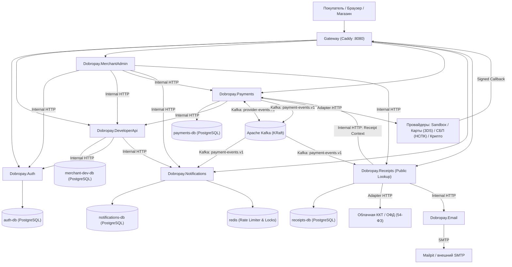
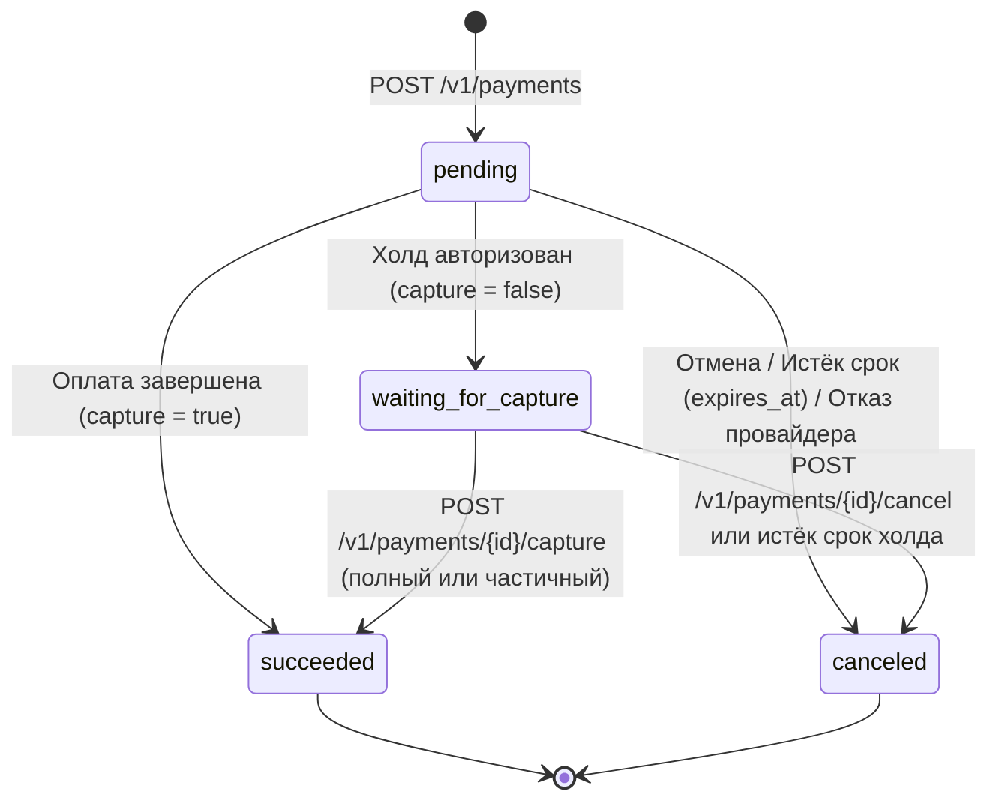
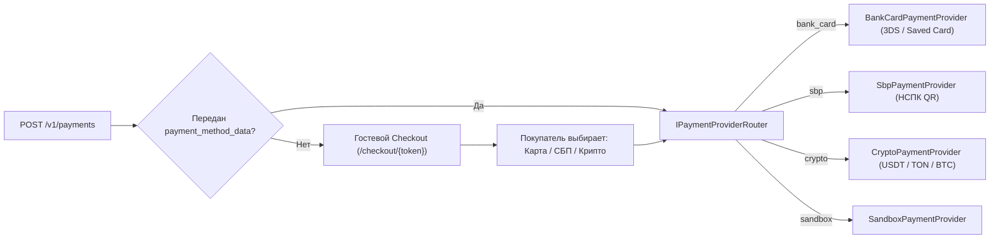
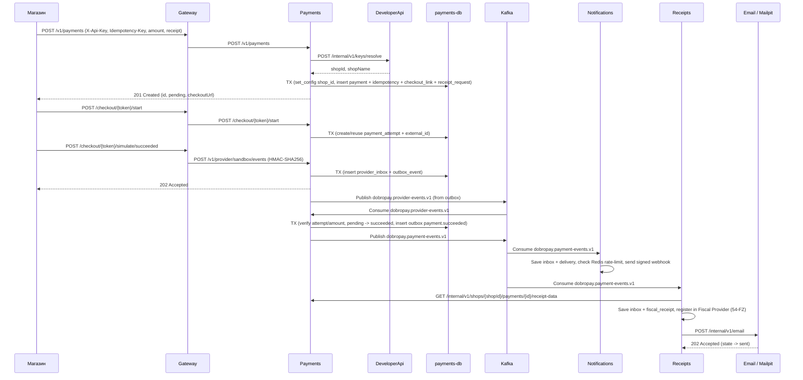

# Архитектура микросервисов Dobropay и проектирование фичей по модели ЮKassa

Dobropay построен по микросервисной архитектуре с паттерном **Database-per-Service**. Каждый доменный сервис разворачивается как отдельный процесс и контейнер, имеет собственную конфигурацию и, при наличии состояния, подключается исключительно к своему собственному физически изолированному контейнеру PostgreSQL через **Entity Framework Core**.

В документе описана как **реализованная базовая архитектура**, так и **проектирование целевых фичей на основе анализа архитектуры ЮKassa**, адаптированное под микросервисный контур Dobropay.

---

## 1. Состав сервисов и границы ответственности

| Сервис | Контейнер | База данных (контейнер / БД) | Текущая ответственность | Расширение по модели ЮKassa (целевые фичи) |
| --- | --- | --- | --- | --- |
| `Dobropay.Auth` | `auth` | `auth-db` / `auth_db` | Аутентификация сотрудников, хранение аккаунтов и активных сессий, проверка токенов по внутреннему API. | Регистрация аккаунтов, refresh-токены, ротация сессий, двухфакторное подтверждение критичных операций в ЛК. |
| `Dobropay.DeveloperApi` | `developer-api` | `merchant-dev-db` / `merchant_dev_db` | Магазины, членство сотрудников, серверные API-ключи (SHA-256 хеши), делегирование настроек webhook в Notifications. | 3-шаговый онбординг бизнеса (анкета организации, ИНН/реквизиты, проверка заявки), разделение контуров `test` (`dp_test_*`) и `live` (`dp_live_*`), ролевая модель (`owner`, `admin`, `developer`, `analyst`), CRUD подписок webhook. |
| `Dobropay.Payments` | `payments` | `payments-db` / `payments_db` | Создание и чтение платежей, идемпотентность, гостевой checkout, симулятор провайдера, приём callback в `provider_inbox`, публикация и обработка событий через Kafka. | Двухстадийные платежи (`waiting_for_capture`, `capture`, `cancel`), полные и частичные возвраты (`Refunds`), маршрутизация провайдеров (`bank_card`, `sbp`, `crypto`), сохранённые способы оплаты (`save_payment_method`), фоновая сверка (`Reconciliation`) и автоотмена по `expires_at`. |
| `Dobropay.Notifications` | `notifications` | `notifications-db` / `notifications_db` + `redis` | Подписки на webhook, потребление событий платежей из Kafka, TTL-лимитирование через Redis, HMAC-SHA256 подпись и доставка с повторами, локальный демо-приёмник. | Подписки по типам событий (`payment.waiting_for_capture`, `payment.succeeded`, `payment.canceled`, `refund.succeeded`, `receipt.succeeded`), SSRF-валидация внешних URL, экспоненциальный backoff до 24 часов, ручной ретрай из кабинета. |
| `Dobropay.Receipts` | `receipts` | `receipts-db` / `receipts_db` | Потребление событий успешной оплаты из Kafka, формирование демонстрационной квитанции, отправка писем через сервис Email. | Полноценная фискализация по 54-ФЗ (чеки `payment` и `refund`, позиции `items` с НДС и признаками предмета/способа расчёта, интеграция с облачной ККТ/ОФД, публичный поиск чека покупателем). |
| `Dobropay.Email` | `email` | Без собственной БД (`mailpit` SMTP) | Приём внутренних запросов на отправку писем и передача в SMTP-сервер. | Шаблонизация писем (квитанция оплаты, чек возврата, уведомления онбординга магазина). |
| `Dobropay.MerchantAdmin` | `merchant-admin` | Без собственной БД | API личного кабинета магазина: проверка токена через Auth, проверка членства через Developer API, чтение платежей, доставок и квитанций через внутренние API сервисов-владельцев. | Агрегация реестров платежей, возвратов, фискальных чеков и вебхуков с фильтрацией и пагинацией, инициирование возвратов и подтверждения холдов из UI кабинета. |

---

## 2. Диаграмма связей (Database-per-Service & Kafka)

---

## 3. Анализ архитектуры ЮKassa и адаптация под фичи Dobropay

Ниже приведён детальный разбор того, как ключевые архитектурные механизмы ЮKassa (API v3) ложатся на микросервисы Dobropay с сохранением изоляции БД (Database-per-Service) и асинхронной шины Kafka.

### 3.1. Жизненный цикл платежа, двухстадийная оплата (Hold / Capture) и `confirmation`

В ЮKassa объект `Payment` поддерживает как одностадийное списание (`capture: true`), так и двухстадийное холдирование (`capture: false`), а также полиморфный объект `confirmation`.

#### Машина состояний платежа (`PaymentStatus`)

#### Ключевые архитектурные решения по модели ЮKassa для `Dobropay.Payments`:
1. **Идемпотентность (`Idempotency-Key`) на каждую мутирующую операцию**:
   - В ЮKassa заголовок идемпотентности применяется не только к `POST /v1/payments`, но и к `POST /v1/payments/{id}/capture`, `POST /v1/payments/{id}/cancel` и `POST /v1/refunds`.
   - В таблице `idempotency_records` (`payments-db`) составной уникальный ключ `(shop_id, operation, idempotency_key)` уже предусматривает поле `operation` (`create_payment`, `capture_payment`, `cancel_payment`, `create_refund`). Ключи хранятся с `request_hash` (SHA-256 канонического JSON) и сохранённым ответом в течение 24 часов.
2. **Сценарии подтверждения (`confirmation`)**:
   - `redirect` — покупатель перенаправляется на `confirmation_url` (гостевой Checkout Dobropay `/checkout/{token}` или ACS-страницу 3-D Secure) и после оплаты возвращается на `return_url` магазина.
   - `qr` — для СБП: в ответе на создание платежа сразу возвращается `confirmation_data` (динамическая ссылка НСПК `https://qr.nspk.ru/...`), чтобы магазин мог отрисовать QR-код на своей странице без редиректа.
   - `embedded` — выдача `confirmation_token` для инициализации встроенного UI-виджета оплаты на сайте магазина.
3. **Детали отмены (`cancellation_details`)**:
   - При переходе в `canceled` фиксируются инициатор (`party`: `merchant`, `payment_network`, `dobropay`) и причина (`reason`: `expired_on_confirmation`, `expired_on_capture`, `canceled_by_merchant`, `insufficient_funds`, `3d_secure_failed`, `permission_revoked`).

---

### 3.2. Возвраты и фоновая сверка (Refunds & Reconciliation)

В архитектуре ЮKassa возвраты (`Refund`) выделены в самостоятельный ресурс `/v1/refunds`, но в транзакционном ядре тесно связаны с балансом конкретного платежа.

#### Архитектурная реализация в `Dobropay.Payments`:
1. **Владение данными**:
   - Таблица `refunds` размещается в `payments-db` (вместе с `payments`), так как проверка доступного остатка (`payment.amount - payment.refunded_amount >= refund.amount`) требует строгой транзакционной согласованности в рамках одной БД.
   - При запросе `POST /v1/refunds` сервис `Payments` загружает `Payment` с блокировкой строки, проверяет статус `succeeded` и достаточность невозвращённого остатка, увеличивает `refunded_amount` (или резервирует сумму), создаёт запись `Refund` со статусом `pending` (или сразу `succeeded`, если провайдер подтверждает синхронно) и пишет событие в `outbox_events`.
2. **Асинхронное подтверждение возврата**:
   - Если провайдер обрабатывает возврат асинхронно, callback провайдера поступает в `provider_inbox` → топик `dobropay.provider-events.v1` → воркер переводит возврат в `succeeded` или `canceled` (при `canceled` зарезервированная сумма возвращается в доступный остаток платежа) и публикует `refund.succeeded` / `refund.canceled` в `dobropay.payment-events.v1`.
3. **Фоновая сверка (`ReconciliationWorker`)**:
   - В ЮKassa при потере или задержке callback от банка-эквайера фоновый процесс опрашивает шлюз провайдера.
   - В `Dobropay.Payments` воркер `PaymentReconciliationWorker` периодически выбирает:
     - `payment_attempts` в состоянии `unknown` / `pending` старше порога ожидания (`next_poll_at <= now`) и вызывает `IPaymentProvider.GetAttemptStateAsync`;
     - платежи в `pending` с `expires_at <= now` и атомарно переводит их в `canceled` (`reason = expired_on_confirmation`);
     - платежи в `waiting_for_capture` с `capture_expires_at <= now` и переводит их в `canceled` (`reason = expired_on_capture`).

---

### 3.3. Провайдеры и методы оплаты (Карты, СБП, Криптовалюта, Автоплатежи)

В ЮKassa выбор способа оплаты может происходить либо **на стороне магазина** (передача `payment_method_data` при создании платежа), либо **на стороне Checkout ЮKassa** (когда `payment_method_data` не передан, и покупатель выбирает способ на платёжной форме).

1. **Банковские карты (`bank_card`) и рекуррентные платежи**:
   - Карточные данные вводятся только на защищённой странице Checkout (или токенизируются), а в `payments-db` сохраняется безопасный слепок `PaymentMethodCard` (`first6`, `last4`, `expiry_month`, `expiry_year`, `card_type`, `issuer_name`).
   - Если при создании платежа передан `save_payment_method: true`, после успешного списания провайдер возвращает токен привязки (`provider_payment_method_token`), который сохраняется в таблице `saved_payment_methods` (`payments-db`, с RLS по `shop_id`). Последующие автоплатежи создаются с `payment_method_id` без участия покупателя (`confirmation` не требуется).
2. **Система быстрых платежей (`sbp`)**:
   - Адаптер `SbpPaymentProvider` формирует в НСПК/банке динамический QR (`qrcId`, `payload` вида `https://qr.nspk.ru/...`) со сроком жизни (по умолчанию 15–30 минут).
   - На странице Checkout (или на сайте магазина через `confirmation.type = "qr"`) отображается QR-код и кнопка СБП (в точном соответствии с центральной карточкой макета `frontend/docs/DESIGN.md`).
   - При оплате входящий callback фиксирует `sbp_operation_id` и `payer_bank_id`. Возвраты по СБП выполняются по связке `sbp_operation_id` через `SbpPaymentProvider.RefundAsync`.
3. **Криптовалюта (`crypto`)**:
   - Для криптоплатежей при старте попытки фиксируется котировка (`exchange_rate`, `crypto_currency`, `crypto_amount`, `network`, `deposit_address`, `quote_expires_at`).
   - Входящие события от крипто-адаптера содержат `tx_hash`, `confirmations`, `required_confirmations` и фактически полученную сумму в токенах. До набора `required_confirmations` попытка находится в промежуточном состоянии `confirming_network`, после чего переходит в `succeeded`.

---

### 3.4. Полноценная фискализация по 54-ФЗ (`Dobropay.Receipts`)

В ЮKassa сервис чеков (`Receipts`) работает асинхронно относительно платежа: платёж переходит в `succeeded` сразу после ответа эквайера, а регистрация чека в онлайн-кассе и ОФД выполняется в фоне по очереди.

#### Как это ложится на `Dobropay.Receipts` (`receipts-db`):
1. **Передача номенклатуры (`receipt`) и защита персональных данных**:
   - Магазин передаёт структуру `receipt` (`customer: { email, phone }`, `items: [...]`, `tax_system_code`) в запросе `POST /v1/payments` или `POST /v1/refunds`.
   - `Dobropay.Payments` сохраняет фискальный payload в таблице `payment_receipt_Requests` (`payments-db`), но **не публикует email/телефон покупателя в открытый топик Kafka** (`dobropay.payment-events.v1`).
   - Когда `Dobropay.Receipts` получает из Kafka событие `payment.succeeded` или `refund.succeeded`, он запрашивает детали корзины и контакты покупателя у `Payments` по защищённому внутреннему маршруту `GET /internal/v1/shops/{shopId}/payments/{paymentId}/receipt-data` (с заголовком `X-Internal-Key`).
2. **Интеграция с ККТ (`IFiscalProvider`)**:
   - В `receipts-db` создаётся запись `FiscalReceipt` (`type: payment | refund`, `status: pending | succeeded | canceled`, позиции `FiscalReceiptItem`, налоговые коды, а также фискальные реквизиты после регистрации: `fiscal_document_number`, `fiscal_storage_number`, `fiscal_attribute`, `ofd_url`).
   - Фоновый воркер `ReceiptFiscalizationWorker` отправляет чек в `IFiscalProvider` (в песочнице — детерминированный `SandboxFiscalProvider`, генерирующий валидные реквизиты ФН/ФД/ФПД; в продакшене — адаптер АТОЛ Онлайн / Orange Data), после чего вызывает `Dobropay.Email` для отправки чека покупателю.
3. **Публичная проверка чека (`#receipts` из `frontend/docs/DESIGN.md`)**:
   - Сервис `Dobropay.Receipts` предоставляет публичный маршрут `GET /v1/receipts/lookup` (проксируемый через Gateway), позволяющий покупателю найти свой чек по номеру заказа/платежа и отобразить карточку чека с позициями, датой, способом оплаты («СБП») и итоговой суммой.

---

### 3.5. Вебхуки, подписи, Rate Limiting и SSRF-защита (`Dobropay.Notifications`)

В ЮKassa система уведомлений гарантирует доставку событий `payment.waiting_for_capture`, `payment.succeeded`, `payment.canceled`, `refund.succeeded` с повторными попытками в течение 24 часов.

1. **Фильтрация по типам событий**:
   - Таблица `webhook_subscriptions` (`notifications-db`) расширяется списком подписанных типов событий (`enabled_events`: `payment.waiting_for_capture`, `payment.succeeded`, `payment.canceled`, `refund.succeeded`, `receipt.succeeded`).
2. **Криптографическая подпись и обратная верификация**:
   - Каждая доставка подписывается заголовками `X-Dobropay-Timestamp` и `X-Dobropay-Signature` (`sha256=HMAC_SHA256(secret, timestamp + "." + raw_body)`).
   - Дополнительно магазин может проверить актуальный статус через `GET /v1/payments/{id}` или `GET /v1/refunds/{id}`.
3. **Расписание повторов (Exponential Backoff + Jitter) и Redis Rate Limiter**:
   - При неуспешном ответе (не `2xx` или таймаут) воркер планирует следующую попытку (`next_at`) по ступенчатой шкале: `15s → 1m → 5m → 15m → 1h → 3h → 6h → 12h` (до достижения `max_attempts`).
   - Перед каждой отправкой проверяется TTL-ключ в Redis (`IRateLimiter`) по магазину; при недоступности Redis отправка безопасно откладывается без списания попытки.
4. **Защита от SSRF (`IWebhookUrlValidator`)**:
   - При регистрации URL подписки (и перед установкой TCP-соединения в production-режиме) проверяется схема (`https://`) и разрешённые IP-адреса DNS-ответа (блокируются `127.0.0.0/8`, `10.0.0.0/8`, `172.16.0.0/12`, `192.168.0.0/16`, `169.254.0.0/16`, `::1`, `fc00::/7`). В локальной песочнице (`SANDBOX_ENABLED=true`) разрешён внутренний адрес демо-приёмника `http://notifications:8080/local/webhooks/receiver`.

---

### 3.6. Онбординг магазина и личный кабинет (`DeveloperApi` + `MerchantAdmin`)

В соответствии с процессом подключения ЮKassa и макетом `frontend/docs/DESIGN.md` (раздел «Как подключить»):
1. **Шаг 1 — Регистрация и создание магазина**: сотрудник регистрируется в `Auth` и создаёт магазин в `DeveloperApi` (сразу доступен тестовый контур `sandbox` и ключи `dp_test_*`).
2. **Шаг 2 — Анкета организации**: заполнение юридических реквизитов (`inn`, `ogrn`, `legal_name`, `bank_bic`, `bank_account`, `website_url`) в таблице `shop_onboarding_profiles` (`merchant-dev-db`).
3. **Шаг 3 — Проверка заявки и боевой режим**: перевод статуса анкеты `draft → under_review → approved`, после чего магазину разрешается выпуск боевых ключей `dp_live_*` и приём реальных платежей.

---

## 4. Сквозной сценарий (Sequence Diagram)

---

## 5. Синхронные и асинхронные взаимодействия

- **Синхронные вызовы (HTTP)**:
  - Используются только для валидации ключей/сессий/членства, настройки подписок, получения контекста чека, агрегации чтения в `MerchantAdmin`, а также вызова `Email` из `Receipts`.
  - Защищены заголовком `X-Internal-Key` (сравнение хешей за константное время) и изолированы внутри Docker-сети.
- **Асинхронные события (Kafka + Transactional Outbox/Inbox)**:
  - Переходы статуса платежа/возврата и бизнес-реакции (`Notifications`, `Receipts`) развязаны через Transactional Outbox в `payments-db` и Transactional Inbox в сервисах-потребителях.
  - Даже при временной недоступности Kafka или соседних сервисов принятые платежи, возвраты и callback'и провайдера надёжно сохраняются в БД и доставляются после восстановления.
