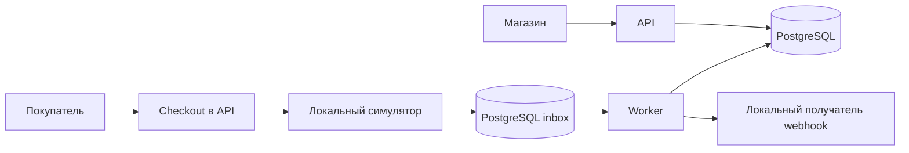
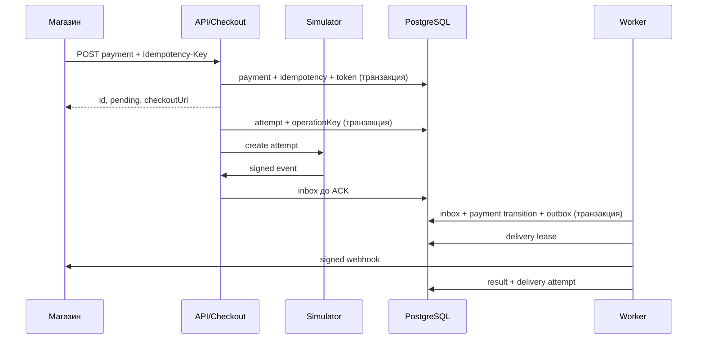

# Архитектура M0–M1

Merchants владеет `shops`, `api_credentials`; Payments — `payments`, `payment_attempts`, `idempotency_records`, `provider_inbox`, `outbox_events`; Checkout — гостевым маршрутом и `checkout_links`; Notifications — `webhook_subscriptions`, `webhook_deliveries`, `webhook_delivery_attempts`. API и Worker обращаются к общей PostgreSQL. `Payments` единолично меняет статус платежа; состояние попытки хранится отдельно.

Платёж переходит только `pending → succeeded|canceled`; терминальный статус не меняется. Попытка остаётся `unknown` до подтверждения. Входящие повторы ограничены уникальным `provider_event_id`. Если внешний ID ещё не записан, Worker откладывает обработку с ограничением числа попыток. Таймаут адаптера сохраняет неизвестный исход; уточнение запланировано для M2. Истечение checkout-токена не меняет платёж.

API определяет магазин по хешу серверного ключа через узкую `SECURITY DEFINER` функцию. Checkout делает точный поиск по хешу токена. Для таблиц магазина включены `ENABLE` и `FORCE ROW LEVEL SECURITY`; политики проверяют `NULLIF(current_setting('app.shop_id',true),'')::uuid` в `USING` и `WITH CHECK`. Runtime-роли не имеют `BYPASSRLS`. Каждый бизнес-запрос открывает транзакцию и задаёт проверенный контекст через параметризованный `set_config`. Worker может читать очередь глобально, но меняет бизнес-строки с контекстом магазина. Задание доставки фиксируется и получает аренду до сетевого запроса; истекшая аренда повторно выбирается.

Запланировано: аккаунты и членство, возвраты, управление подписками, реальный провайдер, сверка и фискализация. Целевая карта подробнее находится в `docs/architecture/ARCHITECTURE.md`.
