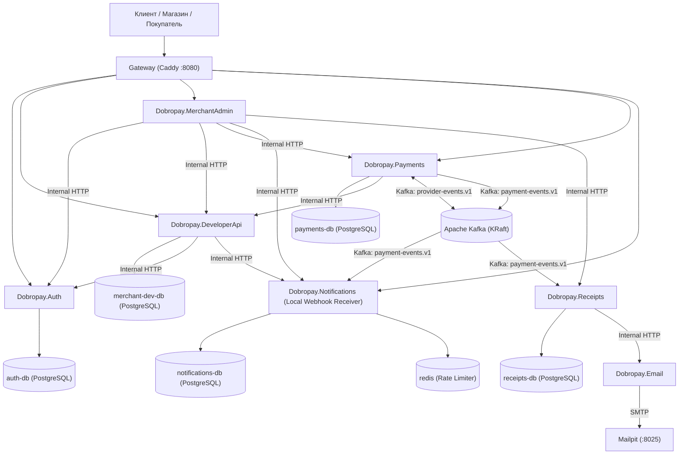
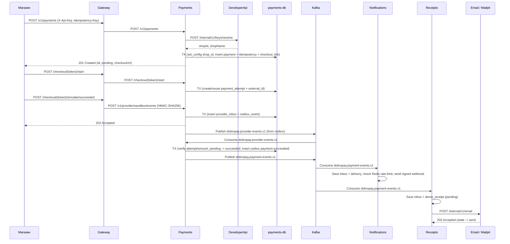

# Архитектура микросервисов Dobropay

Dobropay построен по микросервисной архитектуре с паттерном **Database-per-Service**. Каждый доменный сервис разворачивается как отдельный процесс и контейнер, имеет собственную конфигурацию и, при наличии состояния, подключается исключительно к своему собственному физически изолированному контейнеру PostgreSQL.

## 1. Состав сервисов и границы ответственности

| Сервис | Контейнер | База данных (контейнер / БД) | Ответственность |
| --- | --- | --- | --- |
| `Dobropay.Auth` | `auth` | `auth-db` / `auth_db` | Аутентификация сотрудников, хранение аккаунтов и активных сессий, проверка токенов по внутреннему API. |
| `Dobropay.DeveloperApi` | `developer-api` | `merchant-dev-db` / `merchant_dev_db` | Магазины, членство сотрудников, серверные API-ключи (SHA-256 хеши), делегирование настроек webhook в Notifications. |
| `Dobropay.Payments` | `payments` | `payments-db` / `payments_db` | Создание и чтение платежей, идемпотентность, гостевой checkout, симулятор провайдера, приём callback в `provider_inbox`, публикация и обработка событий через Kafka. |
| `Dobropay.Notifications` | `notifications` | `notifications-db` / `notifications_db` + `redis` | Подписки на webhook, потребление событий платежей из Kafka, TTL-лимитирование через Redis, HMAC-SHA256 подпись и доставка с повторами, локальный демо-приёмник. |
| `Dobropay.Receipts` | `receipts` | `receipts-db` / `receipts_db` | Потребление событий успешной оплаты из Kafka, формирование демонстрационной квитанции, отправка писем через сервис Email. |
| `Dobropay.Email` | `email` | Без собственной БД (`mailpit` SMTP) | Приём внутренних запросов на отправку писем и передача в SMTP-сервер. |
| `Dobropay.MerchantAdmin` | `merchant-admin` | Без собственной БД | API личного кабинета магазина: проверка токена через Auth, проверка членства через Developer API, чтение платежей, доставок и квитанций через внутренние API сервисов-владельцев. |

## 2. Диаграмма связей (Database-per-Service & Kafka)

## 3. Сквозной сценарий (Sequence Diagram)

## 4. Синхронные и асинхронные взаимодействия

- **Синхронные вызовы (HTTP)**:
  - Используются только для валидации ключей/сессий/членства, настройки подписок и агрегации чтения в `MerchantAdmin`, а также вызова `Email` из `Receipts`.
  - Защищены заголовком `X-Internal-Key` (сравнение хешей за константное время) и изолированы внутри Docker-сети.
- **Асинхронные события (Kafka + Transactional Outbox/Inbox)**:
  - Переход статуса платежа и бизнес-реакции (`Notifications`, `Receipts`) развязаны через Transactional Outbox в `payments-db` и Transactional Inbox в сервисах-потребителях.
  - Даже при временной недоступности Kafka или соседних сервисов принятые платежи и callback'и провайдера надёжно сохраняются в БД и доставляются после восстановления.
