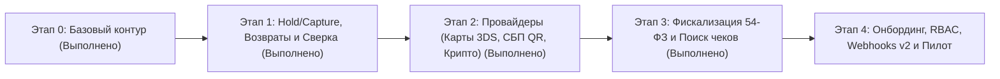

# Дорожная карта Backend (Декомпозиция задач по микросервисам)

Все задачи спроектированы в строгом соответствии со стандартами проекта ([docs/code-style.md](code-style.md)):
- **Database-per-Service**: каждый сервис владеет своей изолированной БД PostgreSQL и обращается к ней исключительно через **EF Core** (без raw SQL).
- **Сначала абстракция, потом реализация**: каждая фича начинается с проектирования `interface` и контрактов в `Dobropay.Contracts`, затем создаются `sealed class` реализации.
- **Один тип — один файл**: каждая сущность, `IEntityTypeConfiguration<T>`, DTO, интерфейс и сервис размещаются в отдельных файлах.
- **Никаких магических строк**: все маршруты, заголовки, статусы, топики и ключи конфигурации выносятся в статические классы констант и типизированные `*Options` из `.env`.

---

## Визуальный план этапов Backend

---

## Этап 0. Базовый микросервисный контур (Выполнено)

- [x] Изоляция 7 сервисов (`Auth`, `DeveloperApi`, `Payments`, `Notifications`, `Receipts`, `Email`, `MerchantAdmin`) и 5 контейнеров PostgreSQL (`auth-db`, `merchant-dev-db`, `payments-db`, `notifications-db`, `receipts-db`).
- [x] Перевод слоя данных всех сервисов на чистый EF Core (`DbContext`, `IEntityTypeConfiguration<T>`, миграции, `IDbSessionFactory`, RLS `app.shop_id`).
- [x] Идемпотентное создание платежа `POST /v1/payments`, гостевой Checkout, локальный симулятор провайдера, Transactional Outbox/Inbox поверх Kafka, доставка подписанных webhook с Redis rate-limiter и отправка демо-квитанций в Mailpit.

---

## Этап 1. Двухстадийные платежи (Hold / Capture), Возвраты и Сверка (`Dobropay.Payments`) — Выполнено

### Эпик 1.1. Двухстадийная оплата (`waiting_for_capture`, `capture`, `cancel`)
- [x] **Задача 1.1.1 — Расширение контрактов (`Dobropay.Contracts`)**:
  - Добавить статус `PaymentStatuses.WaitingForCapture = "waiting_for_capture"` и константы причин отмены `PaymentCancellationParties` / `PaymentCancellationReasons`.
  - Добавить маршруты `PublicRouteNames.PaymentCapture = "/v1/payments/{id:guid}/capture"` и `PublicRouteNames.PaymentCancel = "/v1/payments/{id:guid}/cancel"`.
  - Добавить событие `KafkaContracts.PaymentWaitingForCaptureType = "payment.waiting_for_capture"`.
- [x] **Задача 1.1.2 — Расширение модели EF Core (`payments-db`)**:
  - Добавить в сущность `Payment` поля `Capture` (`bool`), `CapturedAmount` (`long?`), `CapturedAt` (`DateTimeOffset?`), `ExpiresAt` (`DateTimeOffset`), `CancellationParty` (`string?`), `CancellationReason` (`string?`).
  - Создать миграцию EF Core для `PaymentsDbContext`.
- [x] **Задача 1.1.3 — Сервис подтверждения и отмены холда**:
  - Спроектировать интерфейс `IPaymentCaptureService` и реализацию `PaymentCaptureService`.
  - Поддержать частичный `capture` (когда `captured_amount < amount`, а разница автоматически разблокируется у провайдера) с проверкой `Idempotency-Key` (`operation = "capture_payment"` / `"cancel_payment"`).

### Эпик 1.2. Полные и частичные возвраты (`Refunds`)
- [x] **Задача 1.2.1 — Сущность `Refund` и конфигурация EF Core (`payments-db`)**:
  - Создать сущность `Refund` (`Id`, `ShopId`, `PaymentId`, `Amount`, `Currency`, `Status`, `Reason`, `ExternalRefundId`, `CreatedAt`, `CompletedAt`) и `RefundConfiguration : IEntityTypeConfiguration<Refund>` с составным внешним ключом `(ShopId, PaymentId)` на `Payment`.
  - Добавить поле `RefundedAmount` (`long`) в сущность `Payment`.
- [x] **Задача 1.2.2 — Абстракции и бизнес-логика возвратов**:
  - Спроектировать `IRefundRepository`, `IRefundService` и расширить `IPaymentProvider` методом `CreateRefundAsync(RefundProviderRequest, CancellationToken)`.
  - Реализовать атомарный контроль остатка: `payment.CapturedAmount - payment.RefundedAmount >= request.Amount` внутри транзакции `IDbSessionFactory` под RLS-контекстом магазина.
  - Публиковать события `refund.succeeded` и `refund.canceled` через `outbox_events` в топик `dobropay.payment-events.v1`.
- [x] **Задача 1.2.3 — Публичные и внутренние эндпоинты возвратов**:
  - В `Dobropay.Payments`: `POST /v1/refunds`, `GET /v1/refunds/{id:guid}`, `GET /v1/payments/{id:guid}/refunds`, а также внутренний маршрут `GET /internal/v1/shops/{shopId:guid}/refunds`.
  - В `Dobropay.MerchantAdmin`: проксирование списка возвратов и инициация возврата сотрудником магазина (`POST /v1/admin/shops/{shopId:guid}/payments/{id:guid}/refunds`).

### Эпик 1.3. Фоновая сверка (`Reconciliation`) и автоотмена по таймауту
- [x] **Задача 1.3.1 — Абстракция сверки провайдера**:
  - Расширить `IPaymentProvider` методом `GetAttemptStateAsync(string externalAttemptId, CancellationToken)`.
  - Спроектировать `IPaymentReconciliationService` и фоновый воркер `PaymentReconciliationWorker : BackgroundService`.
- [x] **Задача 1.3.2 — Обработка зависших попыток и просроченных платежей**:
  - Опрашивать попытки в статусе `unknown` / `pending` старше настраиваемого интервала (`ReconciliationOptions` из `.env`).
  - Автоматически переводить просроченные платежи (`pending` и `waiting_for_capture` при `expires_at <= UtcNow`) в `canceled` с записью события `payment.canceled` в `outbox_events`.

---

## Этап 2. Провайдеры и способы оплаты: Банковские карты, СБП, Криптовалюта (`Dobropay.Payments`) — Выполнено

### Эпик 2.1. Маршрутизатор провайдеров и полиморфный `confirmation`
- [x] **Задача 2.1.1 — Архитектура `IPaymentProviderRouter`**:
  - Выделить перечисление/константы методов оплаты `PaymentMethodTypes` (`BankCard = "bank_card"`, `Sbp = "sbp"`, `Crypto = "crypto"`, `Sandbox = "sandbox"`) и типов подтверждения `ConfirmationTypes` (`Redirect = "redirect"`, `Qr = "qr"`, `Embedded = "embedded"`, `External = "external"`).
  - Спроектировать `IPaymentProviderRouter`, выбирающий нужную реализацию `IPaymentProvider` по методу оплаты.

### Эпик 2.2. Система быстрых платежей — СБП (`SbpPaymentProvider`)
- [x] **Задача 2.2.1 — Генерация динамического QR НСПК**:
  - Создать `ISbpQrGenerator` и `SbpPaymentProvider : IPaymentProvider`.
  - Формировать `qrc_id` и ссылку `https://qr.nspk.ru/...` со сроком действия, сохранять реквизиты в `PaymentAttempt` (`PaymentMethodType = "sbp"`, `ConfirmationPayload`).
  - Поддержать выдачу QR как на гостевом Checkout (`/checkout/{token}`), так и напрямую в ответе `POST /v1/payments` при `confirmation.type = "qr"`.
- [x] **Задача 2.2.2 — Входящий webhook СБП**:
  - Добавить маршрут `POST /v1/provider/sbp/events` с проверкой HMAC-подписи, сохранением `sbp_operation_id` и банка плательщика в `provider_inbox`.

### Эпик 2.3. Банковские карты (`BankCardPaymentProvider`), 3-D Secure и Автоплатежи
- [x] **Задача 2.3.1 — Маскированные метаданные карт и 3-D Secure**:
  - Создать сущность `SavedPaymentMethod` (`Id`, `ShopId`, `Type`, `CardFirst6`, `CardLast4`, `ExpiryMonth`, `ExpiryYear`, `CardBrand`, `ProviderToken`, `SavedAt`) в `payments-db`.
  - Реализовать `BankCardPaymentProvider : IPaymentProvider` с поддержкой 3-D Secure 2.0 challenge/callback (`POST /v1/provider/card/3ds-callback`).
- [x] **Задача 2.3.2 — Рекуррентные списания (Автоплатежи)**:
  - Поддержать флаги `save_payment_method: true` и `payment_method_id: "<uuid>"` в `POST /v1/payments` для безакцептного списания по сохранённому токену без `checkoutUrl`.

### Эпик 2.4. Крипто-эквайринг (`CryptoPaymentProvider`)
- [x] **Задача 2.4.1 — Котировки курса и мониторинг подтверждений сети**:
  - Спроектировать `ICryptoExchangeRateProvider` и `CryptoPaymentProvider : IPaymentProvider` (сети `USDT-TRC20`, `TON`, `BTC`).
  - Сохранять зафиксированный курс (`ExchangeRate`, `CryptoAmount`, `CryptoCurrency`, `Network`, `DepositAddress`, `QuoteExpiresAt`).
  - Принимать события `POST /v1/provider/crypto/events` с проверкой количества подтверждений (`confirmations >= required_confirmations`).

---

## Этап 3. Полноценная фискализация по 54-ФЗ и публичный поиск чеков (`Dobropay.Receipts`) — Выполнено

### Эпик 3.1. Номенклатура чека (54-ФЗ) и безопасный обмен данными между `Payments` и `Receipts`
- [x] **Задача 3.1.1 — Хранение фискального запроса в `payments-db`**:
  - Принимать в `POST /v1/payments` и `POST /v1/refunds` опциональный объект `receipt` (`customer`, `items`, `tax_system_code`).
  - Сохранять его в сущности `PaymentReceiptPayload` в `payments-db` и отдавать только по внутреннему авторизованному маршруту `GET /internal/v1/shops/{shopId:guid}/payments/{paymentId:guid}/receipt-context` (чтобы PII покупателя не попадали в Kafka).
- [x] **Задача 3.1.2 — Расширение схемы `receipts-db` до стандарта 54-ФЗ**:
  - Создать сущности `FiscalReceipt` (`Id`, `ShopId`, `PaymentId`, `RefundId`, `ReceiptType` [`payment` / `refund`], `Status`, `TaxSystemCode`, `CustomerEmail`, `CustomerPhone`, `FiscalDocumentNumber`, `FiscalStorageNumber`, `FiscalAttribute`, `RegisteredAt`) и `FiscalReceiptItem` (`Id`, `ReceiptId`, `Description`, `Quantity`, `Amount`, `VatCode`, `PaymentMode`, `PaymentSubject`).

### Эпик 3.2. Адаптер облачной ККТ и публичный API поиска чеков
- [x] **Задача 3.2.1 — Абстракция `IFiscalProvider`**:
  - Спроектировать `IFiscalProvider` и реализации (`SandboxFiscalProvider` для локального контура + HTTP-адаптер облачной ККТ).
  - Обновить `ReceiptEventWorker`: при получении `payment.succeeded` или `refund.succeeded` запрашивать контекст чека у `Payments`, регистрировать чек через `IFiscalProvider` и отправлять письмо через `Dobropay.Email`.
- [x] **Задача 3.2.2 — Публичный поиск чека для страницы «Чеки» (`#receipts`)**:
  - Реализовать в `Dobropay.Receipts` публичный эндпоинт `GET /v1/receipts/lookup` (по номеру заказа/квитанции или `paymentId`) и проксировать его в `infra/Caddyfile`.

---

## Этап 4. Онбординг магазина, RBAC, Webhooks v2 и Production Readiness

### Эпик 4.1. Регистрация, 3-шаговый онбординг и роли (`Dobropay.Auth` & `Dobropay.DeveloperApi`)
- **Задача 4.1.1 — Регистрация и управление сессиями в `Dobropay.Auth`**:
  - Добавить `POST /v1/auth/register`, `POST /v1/auth/refresh`, `POST /v1/auth/logout` и `GET /v1/auth/me`.
- **Задача 4.1.2 — Анкета организации и статусы подключения в `Dobropay.DeveloperApi` (`merchant-dev-db`)**:
  - Создать сущность `ShopOnboardingProfile` (`ShopId`, `Inn`, `Ogrn`, `LegalName`, `BankBic`, `BankAccount`, `WebsiteUrl`, `VerificationStatus` [`draft`, `under_review`, `approved`, `rejected`]).
  - Добавить маршруты `POST /v1/developer/shops`, `PUT /v1/developer/shops/{shopId:guid}/onboarding`, `POST /v1/developer/shops/{shopId:guid}/onboarding/submit`.
  - Поддержать выпуск как тестовых (`dp_test_*`), так и боевых (`dp_live_*`) ключей, а также отзыв ключа (`DELETE /v1/developer/shops/{shopId:guid}/keys/{keyId:guid}`).

### Эпик 4.2. Развитие `Dobropay.Notifications` (SSRF-защита, типы событий, ретраи)
- **Задача 4.2.1 — Защита от SSRF (`IWebhookUrlValidator`)**:
  - Реализовать проверку целевого URL подписки и DNS-резолвинга (запрет приватных и loopback IP в боевом профиле).
- **Задача 4.2.2 — Подписки по типам событий и ручной повтор**:
  - Поддержать фильтрацию по `event_types` (`payment.waiting_for_capture`, `payment.succeeded`, `payment.canceled`, `refund.succeeded`, `receipt.succeeded`).
  - Добавить маршрут ручного переотправления доставки `POST /v1/admin/shops/{shopId:guid}/deliveries/{deliveryId:guid}/retry` в `MerchantAdmin` → `Notifications`.

### Эпик 4.3. Наблюдаемость и тестирование (Production Readiness)
- **Задача 4.3.1 — OpenTelemetry и метрики**:
  - Вынести метрики `dobropay_outbox_pending_count`, `dobropay_kafka_consumer_lag`, `dobropay_webhook_delivery_failures_total`, `dobropay_payments_total` через `IMetricsRecorder`.
- **Задача 4.3.2 — Модульные и интеграционные тесты (`tests/Dobropay.UnitTests`)**:
  - Покрыть тестами переходы `waiting_for_capture -> succeeded/canceled`, расчёт частичных возвратов, валидацию SSRF, генерацию чеков 54-ФЗ и идемпотентность всех мутирующих операций.
