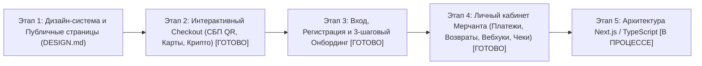

# Дорожная карта Frontend (Декомпозиция задач UI и интеграции с API)

Фронтенд Dobropay строится в строгом соответствии с дизайн-системой [frontend/docs/DESIGN.md](../frontend/docs/DESIGN.md) и объединяет:
1. **Публичный витринный и клиентский контур** (`#home`, `#demo`, `#receipts`, `#connect`) по дизайн-макету `DESIGN.md`.
2. **Платёжный контур покупателя (Hosted Checkout UI)** — страница оплаты `/checkout/{token}` с поддержкой СБП (QR), банковских карт (3-D Secure) и криптовалюты.
3. **Личный кабинет магазина и разработчика (Merchant Admin & Developer Portal)** — онбординг, управление магазинами, реестр платежей/возвратов, чеки и вебхуки.

---

## Визуальный план этапов Frontend

---

## Этап 1. Дизайн-система и публичный портал по `frontend/docs/DESIGN.md` (Исключён из скоупа по ТЗ)

### Эпик 1.1. Токены дизайн-системы, типографика и адаптивный каркас
- **Задача 1.1.1 — Переменные CSS и палитра (`DESIGN.md`)**:
  - Настроить глобальные CSS-переменные: `--blue: #09318D`, `--pink: #F59ACC`, `--white: #FFFFFF`, `--line: rgba(9, 49, 141, .16)`, `--tint: rgba(9, 49, 141, .045)`, `--blush: rgba(245, 154, 204, .24)`, `--glass: rgba(255, 255, 255, .4)`.
  - Настроить системный гротеск и моноширинный стек `--mono`, контейнеры `.wrap` (`min(1180px, 92%)`), `.preview` (`min(960px, 87%)`), `.content` (`min(1040px, 90%)`) и `.receipt` (`min(100%, 370px)`).
- **Задача 1.1.2 — Общая шапка (`.topbar`), капсульное меню (`.nav`) и подвал**:
  - Реализовать логотип `.brand` с розовым знаком (поворот `-12deg`, радиус `55% 55% 55% 12%`), капсулу навигации («Главная», «Чеки», «Как подключить») и кнопки действий (`.button.primary`, `.button.outline`, `.button.login`).
  - Реализовать все адаптивные брейкпоинты из `DESIGN.md`: `max-width: 950px`, `max-width: 700px`, `max-width: 400px` и `min-width: 951px and max-height: 700px`.

### Эпик 1.2. Главная страница (`#home`) и интерактивное демо оплаты (`#demo`)
- **Задача 1.2.1 — Первый экран (`.hero`) и точечный паттерн**:
  - Сверстать градиентный блок `.hero` с радиальным узором `.hero::before`, заголовком с розовой светящейся точкой и подводкой `.lead`.
- **Задача 1.2.2 — Три карточки демонстрации (`.papers`: `.order`, `.payment`, `.notice`)**:
  - Карточка заказа `.order` (поворот `-4deg`, SVG-иконка кружки в блоке `45×45px` на фоне `--blush`, сумма и состав заказа).
  - Центральная карточка оплаты `.payment` (розовый фон `--pink`, сумма `.amount`, плашка/кнопка «Оплатить через СБП»).
  - Карточка уведомления `.notice` (поворот `4deg`, розовый круг подтверждения с синей галочкой, статус оплаты).
- **Задача 1.2.3 — Живой интерактивный запуск демо-платежа**:
  - Подключить кнопку «Оплатить через СБП» в `#demo` к песочнице `POST /v1/payments` → переход или модальный предпросмотр реального цикла `pending → succeeded` с обновлением карточки `.notice`.

### Эпик 1.3. Страница «Чеки» (`#receipts`) и поиск покупки
- **Задача 1.3.1 — Двухколоночный макет `.receipt-layout` и компонент чека `.receipt`**:
  - Сверстать корпус чека с верхней полосой `5px solid var(--pink)`, бейджем статуса «Оплачено», списком реквизитов `dl` с пунктирными разделителями `1px dashed var(--line)` и итогом `.total`.
- **Задача 1.3.2 — Интеграция поиска чека с `Dobropay.Receipts` (`GET /v1/receipts/lookup`)**:
  - Добавить форму быстрого поиска покупки по ID платежа или номеру заказа в карточке «Как найти покупку» (`.receipt-note`), подгружающую реальную квитанцию из `Dobropay.Receipts`.

### Эпик 1.4. Страница «Как подключить» (`#connect`)
- **Задача 1.4.1 — Три шага подключения (`.steps`) с иллюстрациями `.window`**:
  - Шаг `01` — Регистрация (двухколоночное окно `.window` с синей панелью и полями формы).
  - Шаг `02` — Анкета организации (три строки с чекмарками в кругах `23×23px` на фоне `--blush`).
  - Шаг `03` — Проверка заявки (SVG-иконка часов `36×36px`, статус проверки и переход к выпуску ключей).

---

## Этап 2. Платёжная страница покупателя — Hosted Checkout (`/checkout/{token}`) [ВЫПОЛНЕНО]

### Эпик 2.1. Мультиметодный Checkout в стиле ЮKassa и палитре Dobropay
- [x] **Задача 2.1.1 — Переключатель способов оплаты**:
  - [x] Отображение названия магазина, суммы заказа, таймера действия ссылки (30 минут) и вкладок выбора метода:
    1. **СБП (Система быстрых платежей)** — генерация и рендер QR-кода НСПК + кнопка открытия банковского приложения на мобильных устройствах.
    2. **Банковская карта (`bank_card`)** — форма ввода номера карты (с автоопределением Мир / Visa / Mastercard), срока действия, CVV и тогглом «Сохранить карту для следующих покупок».
    3. **Криптовалюта (`crypto`)** — выбор сети (`USDT TRC-20`, `TON`, `BTC`), отображение зафиксированного курса, адреса кошелька с кнопкой копирования и прогресса подтверждений сети.
- [x] **Задача 2.1.2 — Реактивное отслеживание статуса и экран результата**:
  - [x] Polling статуса платежа (`GET /checkout/{token}/status`) с автоматическим переключением экрана в состояние «Оплачено» (с ссылкой на квитанцию и кнопкой возврата в магазин `return_url`) или «Отменено».
  - [x] Панель песочницы (при `SANDBOX_ENABLED=true`) для мгновенной симуляции `Succeeded`, `WaitingForCapture`, `Canceled (Insufficient Funds / 3DS Failed)`.

---

## Этап 3. Аутентификация и 3-шаговый Онбординг магазина [ВЫПОЛНЕНО]

### Эпик 3.1. Экраны входа и регистрации (`Dobropay.Auth`)
- [x] **Задача 3.1.1 — Модальное окно / страница входа и регистрации**:
  - [x] Подключение формы входа к `POST /v1/auth/login` и регистрации к `POST /v1/auth/register`.
  - [x] Хранение сессии, автоматическое подставление `Authorization: Bearer <token>` и редирект неавторизованных пользователей.

### Эпик 3.2. Мастер подключения магазина (`Dobropay.DeveloperApi`)
- [x] **Задача 3.2.1 — Интерактивная анкета организации**:
  - [x] Реализация живого мастера из 3 шагов (соответствующего иллюстрациям `#connect`):
    1. Создание магазина (`POST /v1/developer/shops`).
    2. Заполнение ИНН, ОГРН, названия юрлица и расчётного счёта (`PUT /v1/developer/shops/{shopId}/onboarding`) с клиентской валидацией контрольных разрядов ИНН/БИК.
    3. Отправка анкеты на проверку (`POST /v1/developer/shops/{shopId}/onboarding/submit`) и экран статуса заявки.

---

## Этап 4. Личный кабинет магазина и разработчика (`Dobropay.MerchantAdmin` & `Dobropay.DeveloperApi`) [ВЫПОЛНЕНО]

### Эпик 4.1. Реестр платежей, управление холдами и возвратами
- [x] **Задача 4.1.1 — Таблица и карточка деталей платежа**:
  - [x] Интеграция с `GET /v1/admin/shops/{shopId}/payments` и `GET /v1/admin/shops/{shopId}/payments/{id}`: фильтрация по статусу (`pending`, `waiting_for_capture`, `succeeded`, `canceled`), способу оплаты (`sbp`, `bank_card`, `crypto`) и поиск по `externalOrderId`.
- [x] **Задача 4.1.2 — Действия над платежом (Capture / Cancel / Refund)**:
  - [x] Для платежей в `waiting_for_capture`: кнопки «Подтвердить списание» (с возможностью указать частичную сумму) и «Отменить холд».
  - [x] Для платежей в `succeeded`: модальное окно «Оформить возврат» (полный или частичный возврат с расчётом остатка `amount - refunded_amount` и отображением истории возвратов).

### Эпик 4.2. Раздел разработчика: API-ключи и инспектор Webhook
- [x] **Задача 4.2.1 — Управление API-ключами (`dp_test_*` / `dp_live_*`)**:
  - [x] Выпуск нового серверного ключа (`POST /v1/developer/shops/{shopId}/keys`) с однократным показом секрета и кнопкой копирования, список активных ключей и их отзыв.
- [x] **Задача 4.2.2 — Настройка URL подписок и журнал доставки Webhook**:
  - [x] Форма настройки `url`, `signingSecret` и чекбоксов событий (`PUT /v1/developer/shops/{shopId}/webhooks`).
  - [x] Таблица доставок (`GET /v1/admin/shops/{shopId}/deliveries`) с просмотром HTTP-статуса, числа попыток, времени следующего повтора (`next_at`), просмотром тела/подписи и кнопкой «Повторить доставку».

### Эпик 4.3. Журнал чеков 54-ФЗ и писем
- [x] **Задача 4.3.1 — Реестр фискальных чеков и квитанций**:
  - [x] Интеграция с `GET /v1/admin/shops/{shopId}/receipts`: просмотр статуса фискализации (`pending`, `succeeded`), реквизитов ФН/ФД/ФПД, статуса отправки email (`pending`, `sending`, `sent`) и предпросмотр печатной формы чека (в верстке `.receipt` из `DESIGN.md`).
