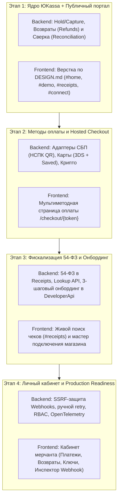

# Дорожная карта развития Dobropay (Обзор и синхронизация Frontend / Backend)

Развитие платформы Dobropay спроектировано на основе анализа архитектуры **ЮKassa (API v3)** с сохранением строгой микросервисной изоляции **Database-per-Service** и асинхронного ядра на базе **Apache Kafka**.

Детальная пошаговая декомпозиция задач разделена на два профильных документа:
- **[Дорожная карта Backend (`docs/roadmap-backend.md`)](roadmap-backend.md)** — декомпозиция по 7 микросервисам, 5 изолированным базам PostgreSQL (EF Core), контрактам Kafka, адаптерам провайдеров и безопасности.
- **[Дорожная карта Frontend (`docs/roadmap-frontend.md`)](roadmap-frontend.md)** — декомпозиция по дизайн-системе [`frontend/docs/DESIGN.md`](../frontend/docs/DESIGN.md), витрине (`#home`, `#demo`, `#receipts`, `#connect`), мультиметодному Checkout и личному кабинету мерчанта.

---

## 1. Реализовано в текущем контуре (Этап 0)

- **Микросервисная архитектура с паттерном Database-per-Service**: 7 независимых сервисов (`Auth`, `DeveloperApi`, `Payments`, `Notifications`, `Receipts`, `Email`, `MerchantAdmin`), 5 физически отдельных контейнеров PostgreSQL с собственными томами, ролями и RLS-изоляцией (`app.shop_id`).
- **Чистый код и ООП**: разделение «один класс — один файл», проектирование от абстракций (`interface`) к реализациям, работа с БД исключительно через EF Core без raw SQL, отсутствие магических строк и полный вынос конфигурации в `.env`.
- **Асинхронный контур через Kafka и Redis**: брокер Kafka (KRaft), паттерны Transactional Outbox / Inbox, идемпотентная обработка, DLQ, TTL-лимитирование через Redis, HMAC-SHA256 подпись исходящих webhook и отправка демо-квитанций через SMTP (Mailpit).

---

## 2. Матрица синхронизации этапов Backend и Frontend

| Этап | Фокус Backend ([подробнее](roadmap-backend.md)) | Фокус Frontend ([подробнее](roadmap-frontend.md)) |
| --- | --- | --- |
| **Этап 1** | Двухстадийные платежи (`waiting_for_capture`, `capture`, `cancel`), полные и частичные возвраты (`POST /v1/refunds`), фоновая сверка (`PaymentReconciliationWorker`) и автоотмена по `expires_at`. | Реализация дизайн-системы `DESIGN.md`, адаптивной шапки, главной страницы с карточками заказа/оплаты СБП/уведомления (`#home`, `#demo`), страниц `#receipts` и `#connect`. |
| **Этап 2** | Маршрутизатор `IPaymentProviderRouter` и провайдеры: СБП (`SbpPaymentProvider`, динамический QR НСПК), Банковские карты (`BankCardPaymentProvider`, 3DS, `save_payment_method`), Криптовалюта (`CryptoPaymentProvider`). | Интерактивный Hosted Checkout (`/checkout/{token}`) с вкладками СБП QR, Банковской карты и Криптовалюты, таймером сессии и реактивным экраном статуса. |
| **Этап 3** | Полноценная фискализация 54-ФЗ в `Dobropay.Receipts` (позиции `items`, НДС, `IFiscalProvider`, чеки прихода и возврата), публичный поиск `GET /v1/receipts/lookup`, 3-шаговый онбординг бизнеса в `DeveloperApi`. | Подключение живого поиска чеков на странице `#receipts`, экраны входа/регистрации и интерактивный 3-шаговый мастер подключения организации. |
| **Этап 4** | Защита внешних URL подписок от SSRF (`IWebhookUrlValidator`), фильтрация по типам событий, ручной повтор доставки из ЛК, кластер Kafka с TLS/ACL и метрики OpenTelemetry/Prometheus. | Полнофункциональный кабинет `MerchantAdmin`: таблица платежей, кнопки Capture/Cancel/Refund, управление ключами `dp_test_*`/`dp_live_*` и инспектор доставки Webhook. |
